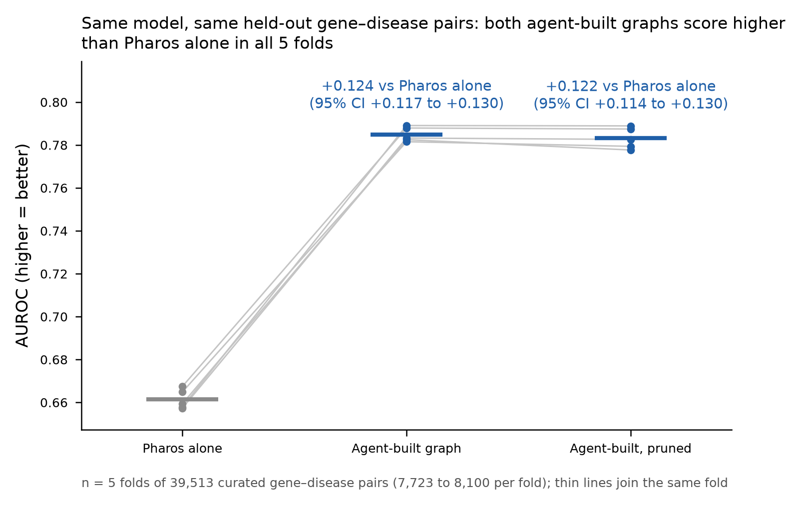

# TrialMindKG

Ask, in plain words, why a drug program failed or how a gene is linked to a disease; each answer lists the source
records it rests on, and each link can be traced back to its source row.

<!-- lead:start -->
**The same path-aware graph model ranks held-out curated gene-disease links better on the enriched graph than on Pharos alone: +0.124 AUROC (95% CI +0.117 to +0.130; higher in 5 of 5 folds), and +0.122 after pruning (95% CI +0.114 to +0.130).**
<!-- lead:end -->



**How:** an agent built a knowledge graph around Pharos (the NIH target database), added public layers to it, gave every
Pharos edge a keep / prune verdict, and tested the result on gene-disease links it had never seen, under a protocol fixed
before the first run. Which kinds of model gain from the added layers and which do not is in the result paragraph below,
computed from the result files.

**Pruning, in plain words:** 256,639 of 26,462,802 Pharos links (0.97%) are marked prune. Of the pruned gene-disease links
that are not text-mined, 0.7% also appear in Open Targets (which the pruning step never reads), against 17.9% of the kept
ones. A blinded check of 100 pruned and 100 kept links did not pass its rule; see
[docs/LIMITATIONS.md](docs/LIMITATIONS.md) section 4.

**Watch it (3 min 46 s):** https://youtu.be/tSY0j3gMtbM (unlisted; synthetic voice-over, captions on screen)

**Try it:** https://d1mdyg1ov91fxt.cloudfront.net/ (questions are answered by NVIDIA Nemotron, at most 20 per visitor per
hour; the second address https://tmkg.16-178-197-241.sslip.io/ serves the same site) · downloads:
https://d1mdyg1ov91fxt.cloudfront.net/downloads/ · what it cannot do: [docs/LIMITATIONS.md](docs/LIMITATIONS.md) ·
architecture: [docs/figures/architecture.png](docs/figures/architecture.png) (caption:
[docs/figures/architecture_caption.md](docs/figures/architecture_caption.md)) · white paper:
[docs/WHITEPAPER.pdf](docs/WHITEPAPER.pdf) ([docs/WHITEPAPER.md](docs/WHITEPAPER.md))

Built for the NVIDIA-AWS BioAgentKG Challenge (2026), open-source track.

**Beyond Pharos:** the same builder, verdicts and checks take any table of findings through a short source card; the
steps and a worked example are in [docs/BRING_YOUR_OWN_SOURCE.md](docs/BRING_YOUR_OWN_SOURCE.md).

## The agent

<!-- agent:start -->
TrialMindKG is a semi-autonomous agent. It runs the loop Ingest, Filter, Clean, Limit, Maintain: it drafts the source card for a new table and builds from it once a scientist approves; a language model turns each question into a validated graph query and summarises the evidence behind each answer; a pruner scores every edge and an auditing step checks edges against literature and interaction databases; a scheduled check watches the sources; every decision is in a dated log.
<!-- agent:end -->

What that means in practice, step by step, and what is not automatic: [docs/AGENT_LOOP.md](docs/AGENT_LOOP.md). The graph
was built and tested by coding agents working under rules written down before each run; a scientist decided the open
questions (which classes, which mappings to exclude, which controls to run). The dated record:

<!-- runlog:start -->
Each row is an entry of the dated ledger `loop/ledger.tsv` (written at the time, including the rejected hypotheses); the numbers are recomputed from the result files by `pipelines/headline.py`.

| date (2026) | what the agent did | rule or decision on record | ledger row |
|---|---|---|---|
| 4 Nov | Ran the frozen benchmark. With the enrichment the plain graph network scored lower (-0.004 AUROC, 95% CI -0.007 to -0.002). | Hypothesis recorded as rejected; the protocol stayed as frozen. | `E001` |
| 6 Nov | Ran the path-aware model that was registered before the run: +0.132 AUROC, 95% CI +0.126 to +0.137 over Pharos alone on that day's build. | Passed its rule, set before the run; the control without the disease hierarchy was queued before any claim. | `E008` |
| 6 Nov | Ran the random-pruning control: the pruned graph against one with the same number of edges removed at random (+0.007 AUROC, 95% CI +0.002 to +0.012). | Registered and approved by the scientist before the graph or any run existed. | `E009` |
| 7 Nov | Finished the control: without the MONDO disease hierarchy the enriched graph scored higher than Pharos alone (+0.033 AUROC, 95% CI +0.029 to +0.037). | Reported next to the result ever since. | `E008 control` |
| 7 Nov | Reported that layers gave the same identifier different classes. | The scientist chose one class per identifier prefix in every product. | `DECISION-OT-classes` |
| 7 Nov | Listed disease mappings whose cross-reference looked wrong, for review. | The scientist excluded five of them; those rows keep their original identifier. | `DECISION-MeSH-exclusions` |
| 9 Nov | Rebuilt the graph with the protein-class layer, scored every edge again, rebuilt the card index and the download files. | Recorded as done; this is the build the downloads hold. | `CS-9 part 1` |
| 10 Nov | Ran the same model once on the shipped graph. Enriched: +0.124 AUROC, 95% CI +0.117 to +0.130. Pruned: +0.122 AUROC, 95% CI +0.114 to +0.130. | Run once, no tuning; this is the result that is quoted. | `D (CS-9 graphs)` |
| 11 Nov | Drew the blinded 200-edge spot check again, from the shipped verdicts. | Amendment written before any row was rated. | `CS-4-spotcheck-amend1` |
<!-- runlog:end -->

## What it does

The graph: **Pharos** (Pharos 3.19.2 / TCRD 6.13.5) as the core, enriched with Open Targets 26.09, ChEMBL 37, the Drug
Target Ontology protein classes that Pharos delivers, and the GO, HPO and MONDO hierarchies, plus a layer of 34 failed drug
programs. Every edge carries its provenance; every Pharos edge carries a **keep / prune verdict** with a confidence and
reasons; every answer cites the edges it rests on.

- **Builds the graph from source cards.** One YAML card per source (`sources/*.yaml`) says how its tables become
  BioLink nodes and edges; one generic builder (`pipelines/kgbuilder/`) reads them all. Pharos is taken as
  delivered: every row whose identifiers can be standardised becomes an edge, and rows that cannot are counted in
  `outputs/<layer>/unmapped.tsv`, not dropped silently.
- **Gives every Pharos edge a verdict.** `pipelines/prune_kg.py` scores each edge (how the source asserted it, the
  source's own score, corroboration by other sources, how well the edge fits the graph, plus hard flags such as an
  implausible activity value) and writes keep / prune, a confidence and the reasons. Pruned edges stay in the
  graph, marked. `pipelines/verdict_file.py` writes one row per Pharos source row with Pharos's own identifiers.
  The confidence is checked against Open Targets, which the pruner never sees
  ([outputs/pharos/prune_calibration.md](outputs/pharos/prune_calibration.md)).
  A blinded check of 200 links under a rule fixed before rating FAILED: 71 of 100 pruned and 56 of 100 kept links were
  judged unsupported (rule: at least 60 and at most 15). Three model raters labelled the rows; on the 39 rows the scientist
  rated blind she agreed with them on 7 of 39, so the raters' labels are not confirmed by a human. A separate machine audit
  of 1,000 links gave 91.8% of pruned and 55.0% of kept links unsupported. Without any model: 1.54% of pruned and 2.40% of
  kept protein-protein rows have an independent IntAct record
  ([spotcheck_blind_result.md](outputs/pharos/spotcheck_blind_result.md),
  [audit_sample_result.md](outputs/pharos/audit_sample_result.md), [ppi_corroboration.md](outputs/pharos/ppi_corroboration.md);
  limits in [docs/LIMITATIONS.md](docs/LIMITATIONS.md), section 4).
- **Tests whether the enrichment helps, fairly.** The same model runs on Pharos alone and on the enriched and pruned
  graphs, on the same held-out curated gene-disease pairs, with negatives matched for disease popularity, paired over
  five folds (`pipelines/linkpred/`; protocol frozen in
  [docs/STRATEGY_REVIEW_RESPONSE_2026-11-02.md](docs/STRATEGY_REVIEW_RESPONSE_2026-11-02.md), section 3). Every run,
  including the ones that showed no gain: [docs/EXPERIMENTS_LINKPRED.md](docs/EXPERIMENTS_LINKPRED.md),
  `python3 scripts/benchmark_quick.py` and the app's Numbers page.
- **Answers questions with the evidence attached.** The web app opens a card for any gene, target, disease or
  compound: known links grouped by kind of evidence, the verdict on each, predicted links with the paths behind
  them, and the failed trials that mention it. "Why" on any row shows its provenance, the same pair in other
  sources and a dated timeline. Answers download as KGX tables plus PyG-ready tables.

<!-- headline:start -->
**The result, in one paragraph** (computed by `pipelines/headline.py` from the files listed under it; the app's Numbers page shows the same text):

On the held-out curated Pharos gene-disease pairs, a graph neural network that also counts the paths between a gene and a disease (GNN + paths) scores higher on the enriched graph that is shipped than on Pharos alone: +0.124 AUROC (95% CI +0.117 to +0.130, 5 of 5 folds higher); +0.122 on its pruned version (95% CI +0.114 to +0.130, 5 of 5 folds higher). Without path counts the enrichment does not help: the plain R-GCN of the frozen protocol scores lower (-0.004, 95% CI -0.007 to -0.002, 0 of 5 folds higher), and a RotatE embedding does not gain (+0.004, 95% CI -0.001 to +0.010, 4 of 5 folds higher) (both measured on the 4 November build). About 75% of the GNN + paths gain comes from the MONDO disease hierarchy (a disease scores well because the gene is already linked to a parent or child term): on the 4 November build, where this control was run, the gain without MONDO is +0.033 (95% CI +0.029 to +0.037, 5 of 5 folds higher) instead of +0.132; the control was not repeated on the shipped graph. Pruning marks 256,639 of the 26,462,802 Pharos edges (0.97%) as prune; 4.1% of them are text co-occurrence and 93% protein-protein interaction rows; across all layers the pruned graph has 390,500 fewer edges (1.32% of 29,680,679). Pruning does not clearly change the GNN + paths score on the shipped graph (-0.002, 95% CI -0.004 to +0.001, 0 of 5 folds higher); for RotatE, on the 4 November build, the pruned graph scores higher than a graph with the same number of edges removed at random (+0.007, 95% CI +0.002 to +0.012, 5 of 5 folds higher). Of the 280 pruned gene-disease edges that are not text-mined, 2 (0.7%) also appear in Open Targets (which the pruner never sees), against 17.9% of the 296,694 kept ones; those 280 are 0.11% of the 256,639 pruned edges, most of which are protein-protein or text-mined, so this check covers few of them. No gold standard of wrong edges exists, so this is confidence re-weighting, not proven error removal. AUROC here is a ranking score on a benchmark, not biological accuracy.

Read from: `outputs/linkpred/G0_B_kfold@diag_gnnpath_1m.json`, `outputs/linkpred/G0_B_kfold@diag_gnnpath_1m_gpu.json`, `outputs/linkpred/G0_B_kfold@diag_kge_rotate_d256.json`, `outputs/linkpred/G0_B_kfold@frozen_a.json`, `outputs/linkpred/G2R_B_kfold@diag_kge_rotate_d256_e009.json`, `outputs/linkpred/G2_B_kfold@diag_gnnpath_1m.json`, `outputs/linkpred/G2_B_kfold@diag_gnnpath_1m_cs9.json`, `outputs/linkpred/G2_B_kfold@diag_gnnpath_1m_nomondo.json`, `outputs/linkpred/G2_B_kfold@diag_kge_rotate_d256.json`, `outputs/linkpred/G2_B_kfold@frozen_a.json`, `outputs/linkpred/G3_B_kfold@diag_gnnpath_1m_cs9.json`, `outputs/linkpred/G3_B_kfold@diag_kge_rotate_d256_e009.json`, `outputs/pharos/prune_report.md`, `outputs/pharos/prune_calibration.json`, `outputs/g2/summary.md`, `outputs/g3/summary.md`.
<!-- headline:end -->

## NVIDIA and AWS services used

Each service below is in use on the hosted site or was used to make what it shows; none is a stand-in.

- **NVIDIA NIM** (model ids and roles in `config/nim_models.yaml`): Nemotron chat models turn a typed question into a
  checked graph query, write the answer summary and check its sentences; the NIM embedding (`nvidia/nemotron-3-embed-1b`)
  and reranking (`nvidia/llama-nemotron-rerank-vl-1b-v2`) models match a drug's research code or trade name to the right
  compound (`pipelines/resolver.py`) and rank the passages of the text-only comparison (`pipelines/rag_baseline.py`).
- **NVIDIA H100**: the path-aware graph model behind the headline number was run on an H100 GPU (`scripts/gpu_kge_run.sh`).
- **Amazon EC2**: the one server that runs the app and the front door. **Amazon S3**: the app bundle, the card index
  (compressed, in parts), the downloads. **AWS Systems Manager**: the model key (Parameter Store) and commands on the
  server (Run Command).
- **Amazon CloudFront**: a second address in front of the same server; it caches the downloads at the edge.
- **Amazon Neptune**: the whole graph as shipped in the downloads, loaded into one Amazon Neptune cluster (1,326,108 nodes
  and 29,295,399 links, equal to the export's manifest; the four pinned check questions return the same evidence;
  `outputs/neptune/live_parity.json`). On the site, "Run this on
  Amazon Neptune" under an answer runs the same checked query there and prints how many evidence links the two answers
  share. The server's own index stays the default answer path (see [docs/LIMITATIONS.md](docs/LIMITATIONS.md), section 6).
- **Amazon CloudWatch, Amazon EventBridge Scheduler, AWS Lambda**: cost and uptime guards. A status alarm watches the
  server; Amazon Neptune is stopped by a small function after 60 minutes without a query (an alarm on query activity
  plus a sweep every 30 minutes), by a nightly schedule, and, until the submission, by hand at the end of each work
  session; a visitor can wake it from the page. Scripts and the cost rules: `aws/README.md`.

## For judges: the brief's agent loop

The brief asks whether an agent can **Ingest, Filter, Clean, Limit and Maintain** a knowledge graph
([docs/organizers/BRIEF.md](docs/organizers/BRIEF.md)). Each step below names the module that does it, the command, and
the test that exercises it; the same table is in the app under **For judges**, and [docs/AGENT_LOOP.md](docs/AGENT_LOOP.md)
says plainly which steps use a language model (Filter) and which are fixed programs (the rest).
One part runs by itself: a weekly source check (`.github/workflows/source_check.yml`) compares each source's current
release with what this repository pulled, writes a dated report and opens an issue when a source has moved on; it
downloads and rebuilds nothing. A scientist approves everything that changes the graph (taking a release, the rebuild,
the diff, the pruning settings, the merge), and the app's dated log (`GET /api/agent-log`) marks those decisions.

| step | what it does | module | command | test |
|---|---|---|---|---|
| Ingest | a source card turns a table into BioLink nodes and edges, with provenance | `pipelines/kgbuilder/engine.py` | `python3 pipelines/build_kg.py sources/pharos.yaml` | `tests/test_kgbuilder.py`, `tests/test_byo_source.py` |
| Filter | a plain-language question becomes one validated graph query; the answer cites its edges | `pipelines/querier.py` | `python3 pipelines/app.py` | `tests/test_querier.py`, `tests/test_subgraph_export.py` |
| Clean | every edge gets keep / prune, a confidence and reasons | `pipelines/prune_kg.py` | `python3 pipelines/prune_kg.py sources/pharos.yaml` | `tests/test_prune.py`, `tests/test_prune_calibration.py` |
| Limit | a card index serves the 26-million-edge graph without loading it into memory | `pipelines/pharos_index.py` | `python3 pipelines/pharos_index.py` | `tests/test_pharos_index.py` |
| Maintain | by itself, weekly: each source's release checked against the repo, dated report, issue when it changed; then, approved by a scientist: re-pull, rebuild, diff against the last build; the monitor names questions to re-run | `pipelines/maintain.py` | `python3 pipelines/maintain.py diff` (weekly check: `python3 pipelines/maintain.py source-check`) | `tests/test_source_check.py`, `tests/test_agent_log.py`, `tests/test_schema_card.py`, `tests/test_monitor.py` |

## Quick start

```bash
python3 -m venv .venv && source .venv/bin/activate
pip install -r requirements.txt
pip install -e .                     # optional: the `trialmindkg` command (trialmindkg --help)
python pipelines/app.py              # http://localhost:8000 (the trial layer works out of the box)
pytest -q
```

**pip:** `pip install .` (or `pip install "git+https://github.com/drkeerthiharikrishnan-h/TrialMindKG-public"`) installs the code with its dependencies from
`requirements.txt` (`pip install ".[ml]"` adds `requirements-ml.txt`) and one command, `trialmindkg`, which runs the
same scripts with the same arguments (`trialmindkg query program_trials pid=P19`). The import name is `pipelines` (a
rename is after-submission work). A pip install carries the code, the page files, `personas/`, `static/` and `config/`;
it does not carry the data folders (`data/`, `outputs/`, `raw/`, `raw_text/`) or the card index, so the full
reproduction needs a clone and [HOW_TO_RUN.md](HOW_TO_RUN.md). Not on PyPI.

The Pharos screen needs the built graph (about 26.5 million edges with protein interactions and text mining),
which is too large for git. To build it:

```bash
python pipelines/pharos.py pull                      # Pharos as delivered -> data/pharos/ (resumable)
python pipelines/build_kg.py sources/pharos.yaml     # -> data/kg/pharos/, outputs/pharos/summary.md
python pipelines/prune_kg.py sources/pharos.yaml     # verdicts
python pipelines/pharos_index.py                     # the app's card index: cards and search without loading the edge table
```

The other layers, the training graphs and the link-prediction runs: [docs/MAINTAIN.md](docs/MAINTAIN.md) (re-pull,
rebuild, diff) and [docs/PIPELINE.md](docs/PIPELINE.md).

## Reproduce and verify

One command each (set-up in [HOW_TO_RUN.md](HOW_TO_RUN.md); every check, what it proves and how long it takes in
[docs/HARNESS.md](docs/HARNESS.md)):

| command | what it does | measured |
|---|---|---|
| `make check` | all tests, the offline click-through of the app, the BioLink schema check | ~12 min (tests 5 + click-through 6.5) |
| `make demo` | builds a small graph of the four EGFR-family genes from real Pharos rows and runs the link-prediction benchmark on it | 49 s - 2 min 4 s (5 cloud runs); Mac 0.6 min |
| `make harness` | the click-through alone (118 clicks + 12 journeys, no model, no network) | ~6.5 min |
| `make hosted-check` | the hosted app, read-only | not yet timed |

`make demo` prints this (cloud run, 10 Nov 2026; another machine can differ in the third decimal). These are **demo, not the reported numbers**: 4 genes and 20 training
rounds instead of the full 26-million-edge graph and 300 rounds; the reported results are in
[docs/EXPERIMENTS_LINKPRED.md](docs/EXPERIMENTS_LINKPRED.md).

```
DEMO (EGFR/ERBB fixture, reduced epochs): demo, not the reported numbers (those are in docs/EXPERIMENTS_LINKPRED.md)
G0: GNN AUROC 0.4276 | meta-path AUROC 0.6913 (coverage 55%) | test pairs per fold 24
G2: GNN AUROC 0.4958 | meta-path AUROC 0.6895 (coverage 55%) | test pairs per fold 24
only 24 test pairs per fold (< 200): these AUROCs are too noisy to compare graphs; the demo shows that every step runs
steps: build pharos 6s, build dto 1s, prune pharos 2s, prune dto 1s, graphs G0,G2 5s, benchmark (demo) 41s, compare 3s
total: 1.0 min | paired comparison: outputs/demo/compare.md
DEMO (EGFR/ERBB fixture, reduced epochs): demo, not the reported numbers (those are in docs/EXPERIMENTS_LINKPRED.md)
```

### From the committed result files to the whole chain

Python 3.11; `pip install -r requirements.txt`, plus `pip install -r requirements-ml.txt` (torch, torch_geometric 2.8.1)
for the link-prediction steps.

- **The numbers, in a minute, from the committed result files:** `python3 scripts/benchmark_quick.py` prints every paired
  comparison the headline above rests on (`pipelines/linkpred/compare.py` on `outputs/linkpred/*.json`).
- **The whole chain** (measured on the owner's Mac unless noted; times from the dated ledger `loop/ledger.tsv`):

| step | command | measured |
|---|---|---|
| Pharos as delivered | `python pipelines/pharos.py pull` | network-bound, resumable |
| layer + verdicts | `python pipelines/build_kg.py sources/pharos.yaml`, `python pipelines/prune_kg.py sources/pharos.yaml` | verdict file ~2.5 h |
| card index | `python pipelines/pharos_index.py [--out PATH]` (default: the newest of `card_index_v3.sqlite`, `card_index_v2.sqlite`, `card_index.sqlite` in `data/kg/pharos_index/` that exists; v3 is the index of the shipped graph, the hosted one) | 2,774 s, 20,286,320,640 bytes (20.3 GB) |
| meta-path predictions | `scripts/predict_metapath_run.sh` | fit 500 s, scoring ~5 min |
| GNN + paths, one graph | `python -m pipelines.linkpred.run ...` (tags in `loop/ledger.tsv`) | ~10.5 h on the Mac (G2), ~2 h on an H100 |

<!-- downloads:start -->
## Downloads

Files that go with the graph (the pruned graph with the trial layer as Amazon Neptune load files, the pruned graph as KGX tables, the verdict file, the pruned graph for PyTorch Geometric); also listed in the app under **For judges**.

| download | what it is |
|---|---|
| [A small sample to open first: EGFR / Epidermal growth factor receptor and its neighbourhood](https://tmkg.16-178-197-241.sslip.io/downloads/sample/) (folder) | 2,663 nodes and 4,705 edges cut from the pruned graph, as KGX tables and as PyTorch Geometric index tables, with a README that shows how to open them in pandas in five lines. SHA256SUMS lists a checksum for every file. (2 MiB) |
| [The pruned graph with the trial layer as Amazon Neptune load files](https://tmkg.16-178-197-241.sslip.io/downloads/neptune/) (folder) | openCypher bulk-load CSV (gzip, at most 1,000,000 rows per file) for every node and every kept edge of the pruned graph with the trial layer (Pharos, the enrichment layers and the trial layer; pruned edges left out), README.md, and manifest.json with the counts, checksums and check questions. The same graph is loaded in Amazon Neptune, which this site uses on request (asleep to save cost; waking takes about 11 minutes); these files load it into your own Neptune. SHA256SUMS lists a checksum for every file. (657 MiB) |
| [The pruned graph as KGX tables](https://tmkg.16-178-197-241.sslip.io/downloads/kgx/) (folder) | nodes.tsv.gz and edges.tsv.gz in the KGX format, every edge with verdict, confidence and reasons. SHA256SUMS lists a checksum for every file. (1448 MiB) |
| [The verdict file](https://tmkg.16-178-197-241.sslip.io/downloads/verdicts/) (folder) | One row per Pharos source row with Pharos's own identifiers, the keep / prune verdict, the confidence and the reasons. SHA256SUMS lists a checksum for every file. (1009 MiB) |
| [The pruned graph for PyTorch Geometric](https://tmkg.16-178-197-241.sslip.io/downloads/pyg/) (folder) | heterodata_G3.pt: the pruned release graph as a PyG HeteroData object (torch_geometric 2.8.1), the graph the link-prediction results were scored on. SHA256SUMS lists a checksum for every file. (1526 MiB) |
<!-- downloads:end -->

## Standards

**The brief's three IRIs, in full.** A protein-coding gene is
[http://purl.obolibrary.org/obo/SO_0001217](http://purl.obolibrary.org/obo/SO_0001217) (the `type` of the 20,162
protein-coding Gene nodes of the 78,883; every other Gene node carries the Sequence Ontology term of its own biotype), a protein is [http://purl.obolibrary.org/obo/PR_000000001](http://purl.obolibrary.org/obo/PR_000000001) (the `type`
of every Pharos protein node), and the link between them carries
[http://purl.obolibrary.org/obo/so#translates_to](http://purl.obolibrary.org/obo/so#translates_to) as its
`original_predicate`. The edge itself is `biolink:has_gene_product`, because BioLink's `translates_to` joins a transcript to
a protein and this graph has no transcript nodes. Counts of the nodes and edges that carry each IRI are the first section of
[docs/SCHEMA_CARD.md](docs/SCHEMA_CARD.md).

**Pharos core and enrichment layers:** BioLink Model classes and predicates only, checked against the model file at build
time. The schema card lists every class and predicate with its IRI, the ontology terms the BioLink model maps it to and the
counts per layer, and says why there are this many classes and no fewer; regenerate it with
`python pipelines/schema_card.py`. The Drug Target Ontology protein classes that Pharos delivers are a layer of the shipped
graph (source card `sources/dto.yaml`; its counts are in the schema card).

**Trial layer:** it describes things BioLink has no specific term for (a trial arm, a registered endpoint, an outcome
result), so it adds terms of its own under the prefix `tmkg:`, never under `biolink:`. Each one names its BioLink parent on
every node and edge; the full list with parents and counts is the last section of the schema card.

Every edge carries `primary_knowledge_source`, `knowledge_level`, `agent_type`, `source_record` and `source_version`.
Exports: KGX TSV and PyG HeteroData for the Pharos graphs; Amazon Neptune bulk-load CSV for the pruned graph with the trial
layer; the trial layer also as GraphML. The same graph is loaded in Amazon Neptune, which this site uses on request (asleep to
save cost; waking takes about 11 minutes): 1,326,108 nodes and 29,295,399 links, equal to the export, and 4 of 4 pinned check
questions return the same evidence there (`outputs/neptune/live_parity.json`). In Amazon Neptune the relationship types are the
sources' relation names (one of them, `0000050`, is BFO part_of with its prefix lost); query by the property
`r.biolink_predicate` for BioLink names. Renaming the types needs a new export.

## The trial layer

34 failed drug programs (3,220 nodes, 5,220 edges) built from ClinicalTrials.gov / AACT, ChEMBL, Open Targets,
GTEx, openFDA FAERS and curated literature, every API response frozen in `data/snapshots/` so the build repeats
byte for byte (`python pipelines/seed_kg.py`). It is the multi-hop part of the demo ("which failed trials
targeted a gene two steps from this one").

> **Internal data in this repository are synthetic.** `data/synthetic/` is generated from stated assumptions
> (`pipelines/adc_demo.py`) and is not sponsor data. Real internal data go in `data/internal/`, which git ignores.

## Data notice

**Licences:** the MIT `LICENSE` covers the code only. Graph rows keep their source, and each source's licence applies;
see [DATA_LICENSES.md](DATA_LICENSES.md) (what was checked, what is still to confirm).

<!-- attribution:start -->
**Data attribution** (written by `python pipelines/attribution.py --write` from `data/curated/attributions.csv`; the app shows the same footer on every page; full record: [DATA_LICENSES.md](DATA_LICENSES.md)). The MIT licence of this repository covers the code only. The data shown here come from the sources below and keep their own licences; reuse of a row follows the licence of its source (every edge names it). Rows from CTD and DisGeNET are for non-commercial use only; rows from ChEMBL are share-alike.

| source | licence | attribution | conditions |
|---|---|---|---|
| [Pharos / TCRD](https://pharos.nih.gov/about) | no licence of its own; each upstream source's licence applies | Data from Pharos 3.19.2 / TCRD 6.13.5 (NCATS), pulled 2026-10-25; cite Kelleher, Sheils et al., Pharos 2023, Nucleic Acids Res., doi:10.1093/nar/gkac1033. | respect each upstream licence |
| [Open Targets Platform](https://github.com/opentargets/platform-docs) | CC0 1.0 | Open Targets Platform 26.09. | none required; cite the latest Open Targets publication |
| [ChEMBL](https://ftp.ebi.ac.uk/pub/databases/chembl/ChEMBLdb/latest/LICENSE) | CC BY-SA 3.0 | ChEMBL 37 (EMBL-EBI). | share-alike: rows derived from ChEMBL stay under CC BY-SA 3.0 |
| [Gene Ontology](https://github.com/geneontology/go-ontology/blob/master/LICENSE) | CC BY 4.0 | Gene Ontology. | attribution |
| [MONDO](https://github.com/monarch-initiative/mondo/blob/master/LICENSE) | CC BY 4.0 | MONDO disease ontology. | attribution |
| [Human Phenotype Ontology](https://hpo.jax.org/license) | HPO licence (custom terms) | This service/product uses the Human Phenotype Ontology (version 2026-09-01). | show the notice with the HPO file version; the ontology is not altered |
| [STRING](https://string-db.org/cgi/access) | CC BY 4.0 | Protein-protein interactions from STRING (via Pharos). | attribution |
| [JensenLab DISEASES](https://diseases.jensenlab.org/Downloads) | CC BY 4.0 | Gene-disease rows from JensenLab DISEASES (via Pharos). | attribution |
| [TIN-X](https://pharos.nih.gov/about) | no explicit licence published; NIH IDG resource | TIN-X text-mining scores (NIH Illuminating the Druggable Genome, via Pharos). | attribution |
| [CTD](https://ctdbase.org/about/legal.jsp) | CTD terms: cite, link to CTD, non-commercial use | Gene-disease rows from the Comparative Toxicogenomics Database (CTD), https://ctdbase.org/ (via Pharos). | cite CTD; hyperlink to the CTD data pages; non-commercial use only |
| [DisGeNET](https://www.disgenet.com/legal) | upstream public release CC BY-NC-SA 4.0; current DISGENET is licensed | Gene-disease rows from the public DisGeNET release (via Pharos). | non-commercial use only; share-alike |
| [ClinicalTrials.gov](https://clinicaltrials.gov/about-site/terms-conditions) | ClinicalTrials.gov terms and conditions | Trial records from ClinicalTrials.gov (via AACT); data processed 2026-10-05. | attribute ClinicalTrials.gov and display the date the data were processed |
| [GTEx](https://gtexportal.org/home/license) | GTEx Portal terms: cite | The data used here were obtained from the GTEx Portal on 2026-10-05. | citation with the date the data were obtained |
| [openFDA (FAERS, Drugs@FDA)](https://open.fda.gov/license) | CC0 1.0 | Adverse-event and regulatory data from openFDA. | none required |
<!-- attribution:end -->

`raw/` and `raw_text/` hold verbatim copies of public documents for the 34 failed programs (registry records, paper
abstracts and supplementary files). The open-access full texts (`raw/**/*fulltext*`) are not redistributed in the
public repository; `pipelines/raw_docs.py` writes them again from Europe PMC. The files keep the contact e-mail
addresses of the authors and sponsors exactly as those public documents print them; nothing there was collected from anyone. Some files in `outputs/` (the trial graph
as CSV, KGX and GraphML) are 8-13 MB because they are the committed, reproducible build.

## Where things are

| | |
|---|---|
| `sources/` | one source card per layer |
| `pipelines/` | builder, pruning, link prediction (`linkpred/`), app (`app.py`, `app_page_v3.html`), connectors |
| `outputs/` | build summaries, pruning reports, link-prediction results (small files, committed) |
| `docs/SUBMISSION.md` | the submission: what was built, the results, the links |
| `docs/LIMITATIONS.md` | what it cannot do, and why |
| `docs/` | schema card, limitations, the agent loop, experiments, maintain procedure, pipeline notes |
| `loop/ledger.tsv` | the dated ledger: every hypothesis, rule, run and decision, written at the time |
| `tests/` | pytest; fixtures only, no real data needed |
