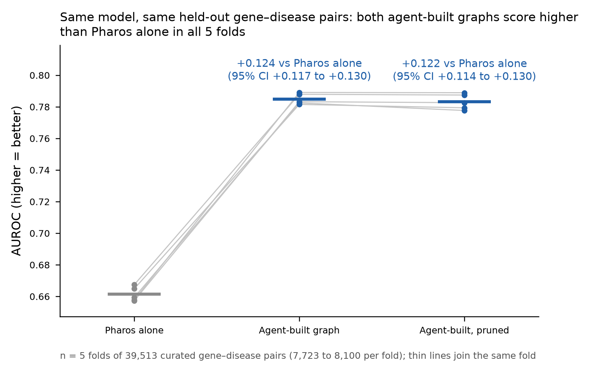

# TrialMindKG - submission

Architecture figure: [docs/figures/architecture.png](figures/architecture.png) (caption:
[docs/figures/architecture_caption.md](figures/architecture_caption.md)). White paper: [docs/WHITEPAPER.pdf](WHITEPAPER.pdf)
(source: [docs/WHITEPAPER.md](WHITEPAPER.md)).

## 1. Judge's card (two pages as a PDF for the form: `docs/JUDGES_CARD.pdf`)

Final version, Sun 15 Nov 2026 (first draft 10 Nov). Every number below is copied or counted from a committed file named in brackets; the
bracketed sources are removed from the PDF. [The live site runs source commit 3399bf62 (final relaunch 15 Nov, serving since
03:56:39 UTC; outputs/review/S18_verify_fix5_fix6_final_relaunch_2026-11-15.md). Documents committed after it are not shown on
the site, so the site is unchanged by them.]

**Hosted site: https://d1mdyg1ov91fxt.cloudfront.net/** (the site's CloudFront address; the site's own address serves the same
pages). The whole repository, the downloads and one command that rebuilds a small demo are described in the README.

**Video (3 min 46 s): https://youtu.be/tSY0j3gMtbM** (unlisted; synthetic voice-over, captions on screen).

**The question.** Can a semi-autonomous agent, with a scientist deciding the open questions, build a knowledge graph that predicts
held-out gene-disease links better than Pharos alone, and clean it as it goes?

**What "agent" means here** (the same paragraph is in the README) [README.md and docs/AGENT_LOOP.md; written
by `pipelines/headline.py`]:

<!-- agent:start -->
TrialMindKG is a semi-autonomous agent. It runs the loop Ingest, Filter, Clean, Limit, Maintain: it drafts the source card for a new table and builds from it once a scientist approves; a language model turns each question into a validated graph query and summarises the evidence behind each answer; a pruner scores every edge and an auditing step checks edges against literature and interaction databases; a scheduled check watches the sources; every decision is in a dated log.
<!-- agent:end -->

**The answer.** Yes for the graph; partial for the model. On the same 39,513 curated Pharos gene-disease pairs, split
5 ways, the same model (a graph neural network that also counts the paths between a gene and a disease) scores **+0.124 AUROC**
higher on the agent-built graph than on Pharos alone (95% CI +0.117 to +0.130; higher in 5 of 5 folds). On the pruned graph it
scores **+0.122** higher (95% CI +0.114 to +0.130; 5 of 5). These are the numbers of the graph that is shipped; the same model on the two
earlier builds of the graph is in one history table of the experiments file and is not quoted anywhere else
[docs/EXPERIMENTS_LINKPRED.md]. Without the
path counts the agent-built graph gives no gain (plain R-GCN -0.004; RotatE embedding +0.004), and about three quarters of the gain comes
from the MONDO disease hierarchy (without it: +0.033 instead of +0.132); these three controls were run once, on the 4 November
build of the graph, and were not repeated on the shipped one. A second model, the meta-path model (the one whose scores appear
on the cards), proposes 112,187 gene-disease links that no source in the graph states yet. That count was made on an earlier
build of the pruned graph (29,270,260 edges; the shipped one has 29,290,179) and has not been redone on the shipped build.
[README.md headline block from pipelines/headline.py: outputs/linkpred/G2_B_kfold@diag_gnnpath_1m_cs9.json,
G3_B_kfold@diag_gnnpath_1m_cs9.json, G0_B_kfold@diag_gnnpath_1m_gpu.json; outputs/linkpred/predictions_novelty.md;
39,513 = the sum of the five per-fold `n_test` values (7,850 + 8,100 + 7,723 + 7,909 + 7,931), identical in those three files]

*Figure. AUROC per fold for the same model on Pharos alone, the agent-built graph and the pruned graph; thin lines join the same
fold; bars are the means; labels give the paired difference against Pharos alone with its 95% interval (+0.124, +0.117 to
+0.130; +0.122, +0.114 to +0.130; 5 of 5 folds each). [drawn by scripts/plot_judges_card.py from outputs/linkpred/G0_B_kfold@diag_gnnpath_1m_gpu.json,
G2_B_kfold@diag_gnnpath_1m_cs9.json, G3_B_kfold@diag_gnnpath_1m_cs9.json; pairing and interval by pipelines.linkpred.compare]*

**Four lines, one per criterion.**

- **Usability (40) - "Can I, a non-expert, use it in two minutes?"** A visitor opens the site, picks one of five roles (physician-scientist,
  clinician, bench scientist, drug-development lead, computational biologist) and clicks a ready question about a failed trial; the answer comes back as a plan, a
  narrative, the evidence behind it and the graph. A visitor can also type a question in plain words. Where to click: the home page, any
  persona card. Every node and edge has a hover card, every answer a written evidence summary, and the graph is interactive.
- **Accuracy and pruning (30) - "What did you remove, and how do I know it was right?"** Every one of the 26,462,802 Pharos edges
  carries a keep/prune verdict with a confidence and reasons; 256,639 (0.97%) are marked prune - 93% of them protein-protein
  interaction rows, 4.1% text co-occurrence. Of the 280 pruned gene-disease edges that are not text-mined, 2 (0.7%) also appear
  in Open Targets (which the pruner never sees), against 17.9% of the 296,694 kept ones; those 280 are 0.11% of the pruned
  edges, so this cross-check covers few of them. No gold standard of wrong edges exists, so this is confidence re-weighting,
  not proven error removal. A blinded check of 200 links under a rule fixed before rating FAILED: 71 of 100 pruned and 56 of
  100 kept links were judged unsupported (rule: at least 60 and at most 15). Three model raters labelled the rows; on the 39
  rows the scientist rated blind she agreed with them on 7 of 39, so the raters' labels are not confirmed by a human. The stored
  independent check of each of those 200 links shows the three raters' judgement; the final label of each row (the scientist's
  where she rated it or settled a disagreement) is in the blinded check's result file. A separate
  machine audit of 1,000 links gave 91.8% of pruned and 55.0% of kept links unsupported; within protein-protein rows from
  STRING, pruned and kept rows are judged unsupported at similar rates, so most of that difference is the mix of sources.
  Without any model: 1.54% of pruned and 2.40% of kept protein-protein rows have an independent IntAct record. Where to click:
  Downloads -> verdict file; Numbers page. [outputs/pharos/prune_report.md; outputs/pharos/prune_calibration.json;
  outputs/pharos/spotcheck_blind_result.md; outputs/pharos/audit_sample_result.md; outputs/pharos/ppi_corroboration.md; 93% and 0.11%: README.md headline block]
- **Explainability (20) - "Where does this edge come from?"** Every edge names its source database, the source row, the
  identifiers, the publications where the source has them, and its verdict; every predicted link shows the paths in the graph that
  produced it and says "predicted, not yet reported". Where to click: any answer -> evidence; any prediction -> path.
- **Standards (10) - "Is it interoperable?"** The Pharos core and the enrichment layers use 12 node classes and 13 predicates,
  all BioLink terms, in a published schema card that also says why there are this many classes and no fewer. The trial layer
  adds 8 classes and 22 predicates of its own under the prefix `tmkg:` for things BioLink has no specific term for (a trial arm,
  a registered endpoint, an outcome result); each names its BioLink parent on every node and edge. The brief's three IRIs are in
  the graph: http://purl.obolibrary.org/obo/SO_0001217 on 20,162 of the 78,883 gene nodes, http://purl.obolibrary.org/obo/PR_000000001 on
  20,412 protein nodes, and http://purl.obolibrary.org/obo/so#translates_to as the original predicate of the 20,190 gene-to-protein
  edges (the edge itself is BioLink's has_gene_product, because BioLink's translates_to starts from a transcript). Exports as KGX
  tables, a PyTorch Geometric graph and Amazon Neptune load files, each with SHA-256 sums. The same graph is loaded in Amazon Neptune,
  which the site uses on request (asleep to save cost; waking takes about 11 minutes): 1,326,108 nodes and 29,295,399 links,
  equal to the download, 4 of 4 pinned check questions with the same evidence [outputs/neptune/live_parity.json]. Where to click:
  Downloads; Schema.
  [docs/SCHEMA_CARD.md, first and last sections; HOW_TO_RUN.md section 3; waking time: docs/LIMITATIONS.md]

**Amazon Neptune - where to click.** Ask any graph question (a ready question or a typed one). Under the answer, "Run this
on Amazon Neptune" runs the same checked query on the whole graph in Amazon Neptune and prints one line: the rows, the time,
and how many evidence links the two answers share ("k of n"; it says identical only when they are). When Amazon Neptune is
asleep to save cost the control reads "Wake it (about 11 minutes)": the answer from the server's own graph stays on screen and
the question runs on Amazon Neptune by itself once it is awake. The Numbers page states what is loaded: 1,326,108 nodes and
29,295,399 links, equal to the download, and 4 of 4 pinned check questions return the same evidence there. The "Runs on" line
at the foot of the first screen names the services this server uses (each only when it is true for it). [outputs/neptune/live_parity.json; waking time: docs/LIMITATIONS.md]

**NVIDIA and AWS services used, and where to see each.** Each is in use on the hosted site or made what it shows; none is a
stand-in. [README.md, section "NVIDIA and AWS services used"; config/nim_models.yaml; aws/README.md; GPUs: loop/ledger.tsv rows
E006 (L40S), E008 result and "D (CS-9 graphs)" (H100)]

| Service | What it does here | Where to see it |
|---|---|---|
| NVIDIA NIM, Nemotron chat models | turn a typed question into a checked graph query; write the short evidence summary under an answer and check each of its sentences against the rows it cites | type a question: the answer opens with its plan, and the summary sits above the rows |
| NVIDIA NIM, embedding and reranking models | match a drug's research code or trade name to the right compound; rank the passages of the text-only comparison | ask about a drug by its research code or trade name |
| NVIDIA H100 and L40S GPUs | the H100 ran the path-aware graph model behind the headline number; the L40S ran the earlier graph-embedding (RotatE) runs | the figure above; the README's reproduce table |
| Amazon EC2 | the one server that runs the site | the hosted link |
| Amazon S3 | holds the site's code bundle, its graph index and the downloads, which the server loads at start | Downloads |
| Amazon CloudFront | a second address in front of the same server; caches the downloads at the edge | the CloudFront address of the site |
| Amazon Neptune | the whole shipped graph, loaded and checked against the download | "Run this on Amazon Neptune" under an answer; the Numbers page |
| AWS Systems Manager | keeps the model key (Parameter Store) and runs commands on the server (Run Command) | not visible on the site; the AWS scripts and their README |
| Amazon CloudWatch, Amazon EventBridge Scheduler, AWS Lambda | a status alarm on the server; Amazon Neptune put to sleep after an hour without a question and every night | the "Wake it" control when Amazon Neptune is asleep; the AWS README |

**Independent reviews before submission.** Three review rounds scored the hosted site against the four criteria. The reviewers
were automated agents given the brief, read-only access and the judging weights; their scores are estimates, not measurements.
After each round the findings were fixed and the site was relaunched.

| Criterion | Weight | 11 Nov (first review) | Round 1, 14 Nov | Round 2, 14 Nov | Round 3, 14 Nov |
|---|---|---|---|---|---|
| Usability | 40 | 26 | 28.5 | 31 | 32.5 |
| Accuracy and pruning | 30 | 18 | 21 | 19 | 23 |
| Explainability | 20 | 14 | 17 | 17.5 | 18 |
| Standards | 10 | 6.5 | 7.5 | 8 | 9 |
| **Total** | 100 | 64.5 | 74 | 75.5 | **82.5** |

Accuracy fell in round 2 because the blinded check had then come out as a FAIL while documents still called it pending; once
stated, it rose to 23. Round 3's reviewer put 86.5 within reach by fixes of 30 minutes or less. Fixes made after round 3 (tighter
rules for the evidence summary; the full experiment log and graph totals on the server) are live and were not re-scored.
Robustness, which is not a judging criterion, was rated 9.2 of 10. No usability test with outside users was run; the scientist's own pass
checked the site in Chrome, Safari and on a phone. [docs/REVIEW_GATE1_2026-11-14.md,
docs/REVIEW_GATE2_2026-11-14.md, docs/REVIEW_GATE3_2026-11-14.md (private repository); hand-off board lines O03, S13b, S13c]

**What it does not do** (the full list is the limitations file, in plain language):

- Keep and prune verdicts are estimates, not proof: no gold standard of wrong edges exists, and the blinded check above failed
  its rule.
- A predicted link is a hypothesis with the paths that produced it, not a finding.
- The graph is a dated snapshot (Pharos 3.19.2, pulled 25 October 2026); nothing updates by itself.
- Answers come from the server's own copy of the graph; Amazon Neptune is the same graph on request, and the two can return
  different rows for the same question (the page says how many evidence links they share).
- Typed questions depend on the hosted model and are limited to 20 per visitor per hour; the ready questions and the stored
  trial answers are the reliable route.
- Rows from CTD and DisGeNET are for non-commercial use only; every row names its source and licence.
[docs/LIMITATIONS.md, sections 2, 4, 5, 6, 7, 8]

**Executive summary (<= 150 words).** TrialMindKG is a knowledge graph that a semi-autonomous agent built around Pharos 3.19.2,
with a scientist deciding the open questions. It added disease, gene-function, phenotype, drug, protein-class and clinical-trial
layers, marked the Pharos edges it could not corroborate as pruned, and kept the lineage of every edge. On held-out curated gene-disease pairs, the same path-aware graph model ranks true links better on the agent-built
graph than on Pharos alone, +0.12 AUROC, in every fold; a plain R-GCN gains nothing, and most of the gain comes from the disease
hierarchy; the site states both. A scientist or clinician can ask a question in plain words and
get a plan, an answer, the evidence and the graph behind it, including what the graph does not know. The pruned graph, the
verdict for every Pharos edge, and the predictions are downloadable; everything is open source, and one command rebuilds a small demo.

---

## 2. Pre-mortem (plan A11; draft 10 Nov for the 15-minute Wed 11 session; re-read Sun 15)

| # | How this loses | Likelihood now | Mitigation in the plan | Evidence a judge can check | Status (updated 15 Nov, S14) |
|---|---|---|---|---|---|
| 1 | Site down or slow during judging (instance, certificate, model quota) | medium | A8 status alarm + runbook; certificate restored from storage at relaunch; GET-only daily check; ask limit per visitor | site answers; status line on the page | alarm and runbook done (S09, docs/RUNBOOK_JUDGING.md; alarm e-mail subscribed 14 Nov); certificate persistence done (CC-42); daily check in place; status alarm OK on the current server after the 15 Nov relaunch (S13c) |
| 2 | A judge cannot understand the first screen | medium-high | A1 first screen = the question, the number, the roles, one ready question each (R11: no internal words) | R11 grep clean | no usability test with outside users was run; Chrome, Safari and phone pass (O03); R11 check runs in the test suite (tests/test_page_pk6.py) |
| 3 | The headline number is questioned (test leakage, same-source argument, "not a GNN") | high | frozen protocol; leakage filter; same-source controls E004-E005; MONDO control; plain-GNN result stated; path model named as graph ML, not a GNN | For judges page: protocol, controls, digest; README headline | all committed; For judges wording on Amazon Neptune corrected in FIX2; R11 check runs in the test suite |
| 4 | Pruning judged weak (0.97% pruned, no gold standard) | high | verdict file for every edge; blinded spot check with pre-registered rule; Open Targets corroboration (2 of the 280 pruned non-text gene-disease edges, 0.7%, vs 17.9% of kept); honest "confidence re-weighting" wording | Numbers page; spotcheck_blind_result.md; verdict file download | spot check FAILED (71 of 100 pruned and 56 of 100 kept judged unsupported; raters agree with the scientist on 7 of 39); stated on the Numbers page, in README and LIMITATIONS |
| 5 | Standards nit-picks (no brief IRIs, classes without terms, "too many classes") | medium | Pharos core and enrichment layers: 12 classes / 13 predicates, all BioLink; trial layer terms listed with BioLink parents; the three IRIs in full with counts; "why these classes" paragraph | Schema page; schema card (first section, "Why these classes", last section) | schema card done (PK5, 11 Nov); live with the full IRIs since 14 Nov, served as committed (Gate 3); the two classes BioLink gives no exact mapping are named as such (owner decision G1-ES-07) |

---

## 3. Demo video script (plan section 8; skeleton 10 Nov, numbers filled Fri 13 from the final pages)

Script: `docs/VIDEO_SCRIPT.md`, version 2 (one failed-trial story, METREO, told with and without the agent-built graph through
the "Read from" switch on tested question 3; usability first). Its timings, shots and number sources are in that file and are not
repeated here. R11 applies to every second.

Recorded: https://youtu.be/tSY0j3gMtbM (unlisted, 3 min 46 s, synthetic voice-over, captions on screen). It follows the script
except in one place: in segment 6 it states that the same graph runs on Amazon Neptune, but it does not show a Neptune answer.

---

## 4. How this differs (for the write-up only; not shown on the site)

Each cell about another project was checked on 11 Nov 2026 against that project's own page: its README, its own paper abstract or
its own "about" page (source in the last column). "Not stated" means the page read does not say; it does not mean the project
cannot do it. Four project sites could not be reached from the build machine (optimuskg.ai, txgnn.org, build.nvidia.com and the
arXiv abstract of OptimusKG), so those rows rest on the projects' GitHub READMEs and journal abstracts only; the TxGNN Explorer
site itself was not read, so nothing is claimed about what it shows.

| Project | What it does (its own words where quoted) | What TrialMindKG adds | What TrialMindKG does not do | Source read |
|---|---|---|---|---|
| Pharos (NCATS) | A web interface to explore the Target Central Resource Database (targets, diseases, ligands), with enrichment calculations on subsets and a GraphQL API (paraphrased; its page asks users to respect each source's own licence) | Takes Pharos 3.19.2 as delivered and adds a keep / prune verdict with a confidence and reasons on every edge, public layers around it, predicted links with the paths behind them, plain-language questions, and KGX / PyG / Neptune files | It does not replace Pharos: no target development levels of its own, no enrichment calculations over target sets, one frozen release instead of a maintained service | pharos.nih.gov/about; abstract of doi:10.1093/nar/gkac1033 |
| OptimusKG (Harvard MIMS) | "A modern biomedical knowledge graph with molecular, anatomical, clinical, and environmental modalities"; "65 heterogeneous resources grounded with 18 ontologies"; validated with a literature agent (PaperQA3); distributed as Parquet; a local bundle for natural-language queries | Is built around Pharos, which the brief asks for; gives a verdict for every Pharos row in Pharos's own identifiers; reports a paired benchmark of the enrichment with its null results; has a hosted site | Far fewer sources (7 layers against its 65 resources); no anatomical or environmental data; no literature check of edges in the shipped version | github.com/mims-harvard/OptimusKG README |
| TxGNN (Harvard MIMS) | "a graph foundation model for zero-shot drug repurposing", pre-trained on a graph of "17,080 clinically-recognized diseases and 7,957 therapeutic candidates"; an Explainer module shows the multi-hop paths behind a prediction; its README points to an Explorer site | Predicts gene-disease links, not drug-disease; states for each graph layer whether it helps under a frozen protocol; every known edge shows its source row and verdict | No drug-repurposing predictions; no zero-shot claim; the model is a path-counting graph model evaluated by a ranking score, not validated against clinical use | github.com/mims-harvard/TxGNN README; abstract of doi:10.1038/s41591-024-03233-x |
| txt2kg (NVIDIA) | "extracts knowledge triples from text and constructs a knowledge graph for visualization and querying"; takes uploaded documents; runs on the user's own hardware | Builds from structured, versioned databases through source cards, so every edge points to a source row; scores edges; ships a fixed, citable graph | It does not extract triples from free text or from a user's documents; a new source must be a table with a source card | github.com/NVIDIA/dgx-spark-playbooks, nvidia/txt2kg README |
| TreeTag | "a lightweight Python package that automatically annotates single-cell RNA-seq data" from a cell-type hierarchy and marker genes; it "prunes unreliable markers" | Nothing comparable: TreeTag is not a knowledge-graph tool. The shared idea is only that an unreliable item is marked from a stated rule and stays inspectable | No single-cell data, no cell-type annotation | github.com/valleyofdawn/TreeTag README |

