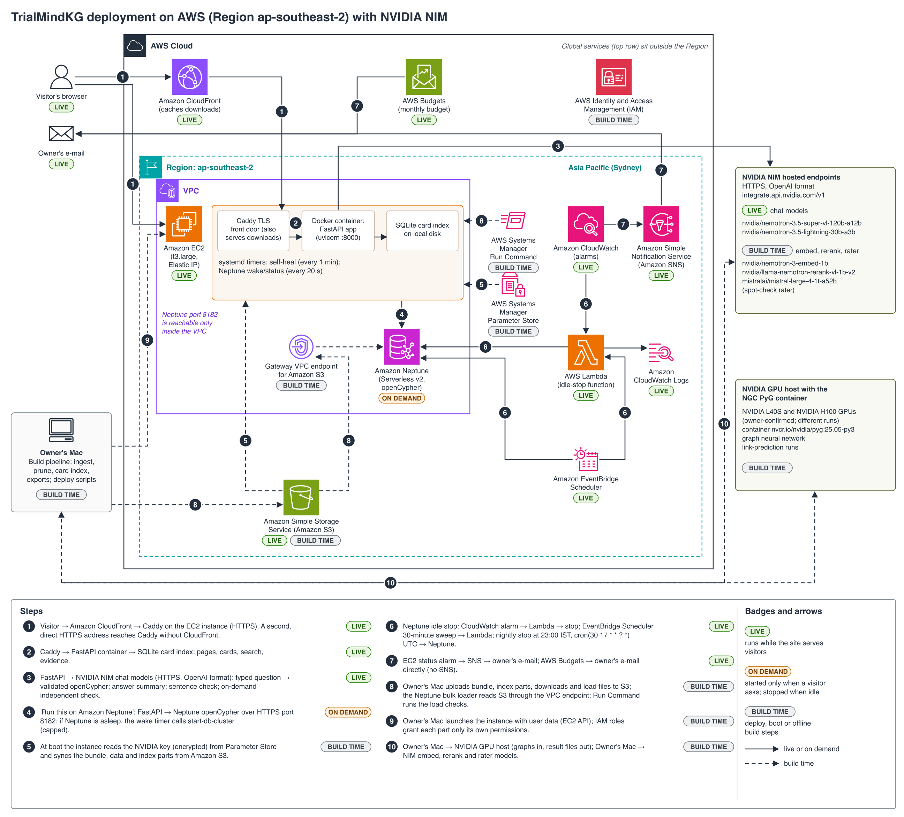
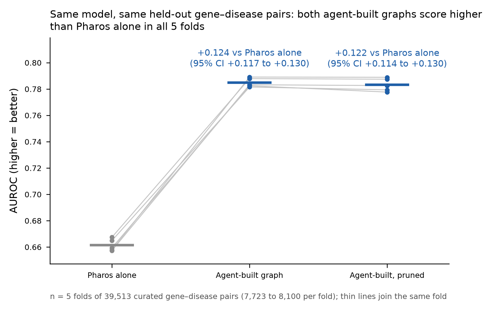
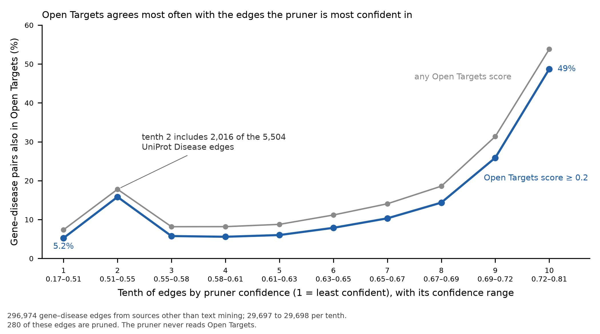

# TrialMindKG: an agent that enriches, prunes and explains the Pharos knowledge graph

*White paper for the NVIDIA-AWS BioAgentKG Challenge. Every number in this paper is read by `scripts/build_whitepaper.py` from a committed result file; the table at the end gives the file and line for each one.*

## Abstract

TrialMindKG is a semi-autonomous agent built around the Pharos knowledge graph of drug targets. It adds evidence from other public sources, gives every edge a keep or prune verdict with a confidence and its reasons, and answers questions in plain language with the evidence behind each answer. On a held-out gene-to-disease link-prediction task, a path-aware graph model scores higher on the enriched graph than on Pharos alone by +0.1235 AUROC (95% interval +0.1167 to +0.1304; higher in 5 of 5 folds). On the enriched and pruned graph the gain is +0.1219 (+0.1139 to +0.1299; 5 of 5 folds). The pruner scored all 26,462,802 Pharos edges and marked 256,639 (0.97%) for pruning. In a graph-embedding model, pruning beats removing the same number of edges at random by +0.0073 (+0.0022 to +0.0124; 5/5 folds). A blinded spot check under a rule fixed before rating FAILED: 71 of 100 pruned edges and 56 of 100 kept edges were judged unsupported, against a rule of at least 60 and at most 15. Against Open Targets, which the pruner never sees, pruned gene-disease edges were found far less often than kept ones: 280 pruned edges at 0.7%, against 296,694 kept edges at 17.9% (edges that are not text mining). Our reading is plain. Enrichment gives the large gain. Pruning keeps it and beats random removal slightly. Kept does not mean confirmed. The system runs on AWS with NVIDIA NIM models, and Amazon Neptune holds the same graph as the download.

## Problem and brief

Knowledge graphs for drug discovery are assembled from many sources. Each source has its own identifiers, its own idea of evidence, and its own errors. Pharos, from the NCATS Illuminating the Druggable Genome programme, is a good core: it covers human targets, diseases, ligands, protein interactions and text-mining links. It also carries the problems of any merged graph. Many links are weak, some are wrong, and a user cannot easily see which is which.

The organisers asked whether an agent, or a swarm of agents, can run one loop over such a graph: Ingest, Filter, Clean, Limit and Maintain. They asked that the result be usable by a non-expert, that it explain where each link comes from, that it follow community standards, and that the approach generalise beyond Pharos. They also asked for evidence that pruning removes the right edges.

We set ourselves three tests. First, does enrichment make the graph more useful for a real task, measured on held-out data with a pre-registered rule? Second, does pruning remove edges that are less likely to be true, measured against evidence the pruner never saw? Third, can a person who is not a graph specialist get a sourced answer from it in a few minutes? This paper reports the answer to each, including the test that failed.

TrialMindKG is the work of one biologist with coding agents. The agents wrote the source cards and programs, ran the experiments and recorded each hypothesis and result in a dated ledger. The scientist decided the open questions: which classes to keep, which mappings to exclude, and which controls to run.

## System overview (the loop)

The system follows the five steps of the brief. The same step table is shown in the app under "For judges" and in `docs/AGENT_LOOP.md`; a test checks that every module it names exists.

**Ingest.** A source card is a short YAML file that says how one table becomes nodes and edges. The builder checks the card against the BioLink model before it reads a row. It gives every edge its source and release. Rows whose identifiers cannot be standardised are counted and listed with the reason, not dropped silently (`pipelines/kgbuilder/engine.py`).

**Filter.** A question in plain language becomes one graph query. A language model drafts the query. A validator checks it against the graph's own classes, relationship types, properties and allowed values before it runs. The answer is the edges that matched, each cited by identifier, strongest evidence first (`pipelines/querier.py`). The edges of one answer can be downloaded as a small graph.

**Clean.** Every edge gets keep or prune, a confidence between zero and one, and the reasons. The score uses how the source asserted the link, the source's own score, agreement between sources, how well the edge fits its neighbourhood, and hard flags such as an implausible activity value. Pruned edges stay in the graph, marked, so nothing is lost (`pipelines/prune_kg.py`). The confidence is then checked against Open Targets, which the pruner never sees.

**Limit.** The brief calls this step probably unnecessary. We keep the whole Pharos graph out of the app's memory. A card index built ahead of time serves search and entity cards from a small database, the pruned graph leaves out pruned edges, and each answer exports only its own sub-graph (`pipelines/pharos_index.py`).

**Maintain.** A weekly check compares each source's current release with the release the repository pulled. It downloads and rebuilds nothing. A scientist approves the re-pull, the rebuild and the re-scoring.

*Figure 1. The loop. Source cards feed the builder (Ingest); the pruner scores every edge (Clean); a language model drafts a query that a validator checks against the graph (Filter); answers return with their evidence and lineage; a weekly release check asks a scientist to approve rebuilds (Maintain). The graph is served from Amazon EC2 and Amazon S3, mirrored in Amazon Neptune, with NVIDIA NIM models for questions and summaries.*

## Data and standards

The core is Pharos 3.19.2 on TCRD 6.13.5. The enrichment layers add Open Targets Platform 26.09 gene-disease associations, ChEMBL 37 compound-target activities and indications, and the hierarchies of MONDO, the Gene Ontology and the Human Phenotype Ontology. A separate trial layer describes 34 failed drug programs, chosen by hand as case studies, with 3,220 nodes and 5,220 edges drawn from ClinicalTrials.gov, openFDA, GTEx and the literature. It is not a registry of all trials.

The Pharos core and the enrichment layers use 12 node classes and 13 predicates, all BioLink terms (`docs/SCHEMA_CARD.md`). A class exists only where an identifier prefix needs it. The Gene Ontology keeps three classes, one for each of its branches, because folding them together would lose which kind of annotation an edge is. Where layers disagree on the class of a term, the term is re-typed so that one identifier has one class everywhere.

The three IRIs named in the brief are in the graph. http://purl.obolibrary.org/obo/SO_0001217 types 20,162 of the 78,883 gene nodes. http://purl.obolibrary.org/obo/PR_000000001 types 20,412 protein nodes. The sequence-ontology relation "translates to" is kept as the original predicate of the gene-to-protein edges. The edge itself uses BioLink's `has_gene_product`, because in BioLink "translates to" joins a transcript to a protein, and this graph has no transcript nodes.

The trial layer needs things BioLink has no specific term for: a trial arm, a registered endpoint, an outcome result. These use classes and predicates under the prefix `tmkg:`, and each names its BioLink parent on every node and edge.

Every edge carries its primary knowledge source, its knowledge level (for example a curated assertion, a statistical association or a text co-occurrence), its agent type, the source row and the card version. The graph is exported as KGX tables, a PyTorch Geometric graph and Amazon Neptune load files, each with SHA-256 sums. The Neptune copy holds 1,326,108 nodes and 29,295,399 links; its counts are equal to the download, and 4 of 4 pinned check questions return the same evidence there (`outputs/neptune/live_parity.json`).

## Link-prediction benchmark

**Task.** The benchmark asks whether a model can recover gene-to-disease links that were removed from the graph. The held-out links are split into folds. Each fold holds between 7,723 and 8,100 test pairs (key `n_test` in each result file), and the three graphs are tested on the same pairs: each result file carries a digest of its test set, and the comparison reports whether they match. Negative pairs are matched on node degree. Links that would leak the answer are removed from training. Training is capped at the same number of edges per edge type on both sides of every comparison.

**Statistics.** Each comparison is a paired difference per fold, with a 95% interval over the folds, and a count of the folds in which the variant scores higher. Each confirmatory experiment had its rule written before its result was seen; exploratory runs are marked as such. Every result, including the null ones, is in `docs/EXPERIMENTS_LINKPRED.md`.

**Model.** The headline model combines a relational graph network with features counted on the paths between a gene and a disease. It ran on an NVIDIA H100.

| Graph | Mean AUROC | Difference from Pharos alone | 95% interval | Folds higher |
|---|---|---|---|---|
| Pharos alone | 0.6614 | | | |
| Enriched | 0.7849 | +0.1235 | +0.1167 to +0.1304 | 5 of 5 |
| Enriched and pruned | 0.7832 | +0.1219 | +0.1139 to +0.1299 | 5 of 5 |

*Figure 2. AUROC per fold on Pharos alone, the enriched graph, and the enriched and pruned graph. Thin lines join the same fold. Enriched minus Pharos alone: +0.1235 (+0.1167 to +0.1304). Enriched and pruned minus Pharos alone: +0.1219 (+0.1139 to +0.1299).*

**What carries the gain.** Three controls bound the headline.

- A plain message-passing graph network, run under the frozen protocol on an earlier build of the graphs, gains nothing: -0.0045 (-0.0064 to -0.0026; 0/5 folds higher). It builds one vector per node and cannot count the paths between a gene and a disease, which is where the new signal is. The path-aware model was chosen after this null result.
- Most of the path gain comes from the MONDO disease hierarchy: about 82% for the meta-path model when MONDO is dropped. A gene linked to a parent or child of a disease is predicted for that disease. This is legitimate and explainable, but it is partly a restatement of existing knowledge at a neighbouring level of the ontology.
- Without MONDO, the enriched graph still beats Pharos alone with the headline model: +0.0329 (+0.0293 to +0.0366; 5/5 folds). MONDO carries about 75% of that model's gain.

The model's predictions are hypotheses, not findings. Of the 277,490 predictions of the meta-path model on the enriched and pruned graph, 112,187 (40.4%) are in no layer of the graph and do not merely name an ancestor of a known disease. Each prediction shows the paths that produced it and says that it is predicted, not reported.

## Pruning and evaluation

**What was pruned.** The pruner scored all 26,462,802 Pharos edges and marked 256,639 (0.97%) for pruning. No gold standard of wrong edges exists for Pharos. The verdicts are therefore a confidence re-weighting, not proven error removal. We tested them four ways.

**Effect on the benchmark.** Pruning keeps the headline gain: +0.1219 over Pharos alone against +0.1235 for the enriched graph. For a graph-embedding model (RotatE) trained for the same number of epochs on every graph, the enriched and pruned graph beats the enriched graph by +0.0038 (+0.0007 to +0.0068; 5/5 folds). The key control removes the same number of edges per edge type at random. The enriched and pruned graph beats this random-pruning control by +0.0073 (+0.0022 to +0.0124; 5/5 folds), while random removal itself changes the score by -0.0035 (-0.0085 to +0.0015; 1/5 folds). The gain therefore comes from which edges the verdicts remove, not from removing edges as such. The effect is small.

**Open Targets cross-check.** Open Targets lists 769,960 gene-disease pairs, and the pruner never sees them. Of the 296,974 Pharos gene-disease edges that are not text mining, 296,694 are kept and 280 are pruned. Of the kept edges 17.9% are also in Open Targets; of the pruned edges 0.7% are. The pruned group is small, so this check covers few of the pruned edges. Across confidence deciles the share in Open Targets rises from 7.4% in the least confident decile to 53.8% in the most confident.

*Figure 3. Share of non-text-mining Pharos gene-disease edges also asserted by Open Targets, by decile of pruning confidence (least confident on the left).*

For protein interactions, an independent check without any model gives a weaker signal. An independent IntAct record exists for 1.54% of pruned and 2.40% of kept protein-protein rows.

**Blinded spot check (pre-registered).** Before rating began we fixed a rule. The check would pass if at least 60 of 100 pruned edges were judged unsupported and at most 15 of 100 kept edges were. The rows were shuffled and the verdicts hidden. Three model raters labelled each row: two NVIDIA Nemotron models and one Mistral model. The scientist rated 40 rows blind and adjudicated flagged rows.

The check FAILED. 71 of 100 pruned edges were judged unsupported (rule: at least 60), which meets its half of the rule. 56 of 100 kept edges were also judged unsupported (rule: at most 15), which fails badly. Among pruned edges 26 were judged supported and 3 could not be told; among kept edges, 38 and 6. The final label came from the scientist's blind label on 39 rows, from agreement of all three raters on 136, from her adjudication on 23 and from the raters' majority on 2. The raters agreed among themselves on 168 of 200 rows (84.0%). On the rows she rated, the scientist agreed with the raters' majority label on 7 of 39 (17.9%), Cohen's kappa -0.04. The pre-registered level for treating the machine labels as checked was 32 of 40. The raters' labels are therefore not confirmed by a human. The stored independent-check records of the 200 spot-check rows carry the raters' judgement; the final label of each row is in `outputs/pharos/spotcheck_blind_result.md`.

**Independent audit sample (no pre-registered rule).** A separate sample of 500 pruned and 500 kept edges was labelled by the same three raters only. 459 pruned edges were judged unsupported, 91.8% (89.1% to 93.9%); 275 kept edges were, 55.0% (50.6% to 59.3%). This sample had no pass rule and was never mixed into the spot check. Within protein-protein rows from one source, pruned and kept rows are judged unsupported at similar rates, so much of the difference is the mix of sources.

**After-the-fact analysis (not pre-registered).** We broke down the 56 kept edges judged unsupported in the spot check by evidence type. The counts are computed by the build script from the final labels the scorer uses, joined to each row's knowledge level and source, and by how the final label was reached.

| Knowledge level | Kept edges judged unsupported |
|---|---|
| knowledge_assertion | 34 |
| text_co_occurrence | 21 |
| statistical_association | 1 |
| **Total** | **56** |

| Source | Kept edges judged unsupported |
|---|---|
| STRINGDB (infores:string) | 33 |
| TIN-X (infores:pharos) | 21 |
| Pharos target-gene mapping (infores:pharos) | 1 |
| TIGA (GWAS Catalog) (infores:tiga) | 1 |
| **Total** | **56** |

| How the final label was reached | Kept edges judged unsupported |
|---|---|
| raters agree | 49 |
| owner adjudicated | 4 |
| owner blind | 3 |
| **Total** | **56** |

Nearly all of the kept-but-unsupported rows are protein-interaction rows from STRING or text co-occurrence links from TIN-X. Both are weak kinds of evidence. This analysis was planned after the result was known and does not change it.

**Conclusion on pruning.** Enrichment gives the large gain. Pruning keeps it and beats random removal slightly. Kept does not mean confirmed: in both samples a large share of kept edges, especially text-mined and protein-interaction rows, had no support the raters could find.

## Explainability (edge lineage)

Every edge can be traced. Its card names the source database and release, the source row, the identifiers at both ends, the publications where the source gives them, the knowledge level, and the keep or prune verdict with its confidence and reasons. A user reaches this card by hovering on an edge or clicking "why" next to it.

Every answer to a question opens with its plan: the graph query that was run, after validation. A short written summary sits above the evidence rows. A language model writes the summary, and a second check tests each of its sentences against the rows it cites. Every predicted link shows the graph paths that produced it and is marked "predicted, not yet reported".

*Figure 4. The evidence record of one edge in the app, opened from an answer about a trial of mepolizumab in COPD: the statement with its predicate, the source record in ClinicalTrials.gov, the evidence type and retrieval time, the knowledge source and the knowledge level with its agent. The record continues below the part shown.*

The limits are real. Publications are counted on many links, but their PubMed identifiers are not carried for every source. Several sources have no link to their own record page. A predicted link's band ranks pairs; the card does not yet show how often each band was right on held-out links.

## Usability (how a non-expert uses it)

A visitor opens the site and picks one of five roles: physician-scientist, clinician, bench scientist, drug-development lead, or computational biologist. Each role offers ready questions, many about a failed drug program. Clicking one returns a plan, a short narrative, the evidence rows behind it and an interactive graph. A visitor can also type a question in plain words. Every node and edge has a hover card. Every answer can be downloaded as a small graph.

Stored worked examples answer in 3.50 s to 3.92 s. A typed question took 50.56 s (median) in a latency run, because it calls a language model to draft and check the query. We therefore lead new users to the ready questions first. Typed questions to the trial layer can fail; the stored trial answers and the program cards are the reliable route there. Questions about a whole drug class are refused rather than answered loosely.

Evidence of usability is thin. No usability test with outside users was run; the site was checked only in the owner's own pass in Chrome, Safari and on a phone.

## Deployment on AWS with NVIDIA

The site runs on one Amazon EC2 server in the ap-southeast-2 region (region read from `docs/RUNBOOK_JUDGING.md`). Amazon S3 holds the code bundle, the graph index and the downloads, which the server loads at start. Amazon CloudFront gives a second address in front of the same server and caches the downloads. AWS Systems Manager keeps the model key in Parameter Store and runs commands on the server. Amazon CloudWatch raises a status alarm, and Amazon EventBridge Scheduler with AWS Lambda puts Amazon Neptune to sleep after an hour without a question and every night, to save cost.

Amazon Neptune holds the whole shipped graph. Under any answer, "Run this on Amazon Neptune" runs the same validated query there and prints the rows, the time, and how many evidence links the two answers share. When Neptune is asleep, the control offers to wake it, which takes about 11 minutes; the answer from the server's own graph stays on screen meanwhile.

NVIDIA NIM serves the language models. Nemotron chat models turn a typed question into a checked graph query and write and check the evidence summary. NIM embedding and reranking models match a drug's research code or trade name to the right compound. The path-aware model behind the headline ran on an NVIDIA H100; the earlier graph-embedding runs ran on an NVIDIA L40S.

The hosted site is at https://d1mdyg1ov91fxt.cloudfront.net/. A short video walks through one question on it: https://youtu.be/tSY0j3gMtbM.

## Generalising to new sources

Nothing in the loop is specific to kinases or to Pharos. A new source is one new source card. `docs/BRING_YOUR_OWN_SOURCE.md` walks a non-programmer through five steps, in about 10 minutes, with a worked example in `examples/byo_source/` whose values are labelled SYNTHETIC.

1. Put the table in a folder as a gzipped, tab-separated file, one finding per row.
2. Copy the example card and edit it: which columns hold the two ends of the edge, which BioLink class and identifier system each uses, which BioLink predicate joins them, and who asserts it and how.
3. Build it. The builder checks the card against BioLink first, so an impossible relationship such as "protein treats protein" is refused with a message. Rows whose identifiers cannot be standardised are listed with the reason, never guessed. The example gives 9 nodes and 6 edges.
4. Score it. The same pruner gives every edge a verdict, a confidence and the reasons. With one small source it has little to compare with, so the example's verdicts only illustrate the output.
5. Use it with the rest of the graph. Layers merge by identifier, so a protein in the new table shares a node with the Pharos evidence, and its card lists the new finding next to the others with its own source and verdict.

Every edge of a new layer carries the same provenance contract as Pharos edges. One card describes one source, so several sources become several layers, which is what makes agreement between sources visible to the pruner. A test (`tests/test_byo_source.py`) exercises the example. A science that needs a class BioLink lacks uses a `tmkg:` term and says so, as the trial layer does.

## Limitations

- **The pruning check failed.** The kept set contains many edges that raters could not support. Pruning is a confidence re-weighting, not error removal.
- **The machine labels are not confirmed by a human.** The scientist agreed with the raters' majority on 7 of 39 rows.
- **The headline gain is mostly ontology smoothing.** About 75% of the path-aware model's gain comes from the MONDO hierarchy. The model was chosen after the frozen protocol showed no gain for a plain graph network, and some controls were run on an earlier build of the graphs.
- **The graph is a snapshot.** Nothing in it is newer than its source releases. Maintenance is a procedure a person approves; no program rebuilds the graph by itself.
- **Coverage.** The graph is human only, with no patient data, no genotypes, no transcripts and no cell types. Absence of a link is not evidence of absence.
- **Most gene-disease links are text mining.** Pharos contributes 13,118,763 text co-occurrence gene-disease links against 296,974 that are not. Each row says which kind it is.
- **No usability test with outside users was run.** The only check was the owner's own pass in Chrome, Safari and on a phone.
- **Known gaps** in this version are listed in `docs/LIMITATIONS.md`. Examples: a disease card lists a limited number of links of each kind, ordered by pruning confidence rather than strength of genetic signal; antibodies from ChEMBL are typed as small molecules; and the held-out test links are rebuilt by code rather than shipped as a download.

## Reproducibility and licences

`HOW_TO_RUN.md` gives the set-up and four commands: the test suite with the app click-through and schema checks, a small end-to-end demo with the frozen benchmark command, an offline click-through of the app, and a read-only check of the hosted site. Python dependencies are pinned in `requirements.lock.txt`, and the server image is built from `aws/Dockerfile`. Large data that is not in git is listed with its source, release and how to fetch it. Each benchmark result file carries a digest of its test set, so a rerun can show it used the same links. The experiment ledger (`loop/ledger.tsv`) records each hypothesis and rule before its run.

The code is under the MIT licence (`LICENSE`). The data keep the licences of their sources, and every link names its source, so the licence of any row can be traced. Rows from CTD and DisGeNET are for non-commercial use only. Rows from ChEMBL are share-alike. The Human Phenotype Ontology, ClinicalTrials.gov and GTEx ask for specific attribution lines. The full table is `DATA_LICENSES.md`; it is not legal advice. To cite a fact found here, cite its source, which the link names. To cite the graph, give its name, the repository address and the commit used, because the graph is a dated snapshot.

## Appendix: sources of numbers

Each number above was read by `scripts/build_whitepaper.py` from the file and line or key below. Tracked = the file is in git (`git ls-files`).

| id | value | file | line or key | tracked |
|---|---|---|---|---|
| ci_level | 95% | `outputs/linkpred/compare_cs9_gnnpath.md` | line 5 | yes |
| enr_n | 5 | `outputs/linkpred/compare_cs9_gnnpath.md` | line 7 | yes |
| enr_d | +0.1235 | `outputs/linkpred/compare_cs9_gnnpath.md` | line 7 | yes |
| enr_lo | +0.1167 | `outputs/linkpred/compare_cs9_gnnpath.md` | line 7 | yes |
| enr_hi | +0.1304 | `outputs/linkpred/compare_cs9_gnnpath.md` | line 7 | yes |
| enr_folds | 5 | `outputs/linkpred/compare_cs9_gnnpath.md` | line 7 | yes |
| prn_n | 5 | `outputs/linkpred/compare_cs9_gnnpath.md` | line 9 | yes |
| prn_d | +0.1219 | `outputs/linkpred/compare_cs9_gnnpath.md` | line 9 | yes |
| prn_lo | +0.1139 | `outputs/linkpred/compare_cs9_gnnpath.md` | line 9 | yes |
| prn_hi | +0.1299 | `outputs/linkpred/compare_cs9_gnnpath.md` | line 9 | yes |
| prn_folds | 5 | `outputs/linkpred/compare_cs9_gnnpath.md` | line 9 | yes |
| auroc_pha | 0.6614 | `outputs/linkpred/G0_B_kfold@diag_gnnpath_1m_gpu.json` | key per_seed[0].auroc_gnnpath | yes |
| auroc_enr | 0.7849 | `outputs/linkpred/G2_B_kfold@diag_gnnpath_1m_cs9.json` | key per_seed[0].auroc_gnnpath | yes |
| auroc_prn | 0.7832 | `outputs/linkpred/G3_B_kfold@diag_gnnpath_1m_cs9.json` | key per_seed[0].auroc_gnnpath | yes |
| ntest_min | 7,723 | `outputs/linkpred/G2_B_kfold@diag_gnnpath_1m_cs9.json` | min over key per_seed[0].folds[*].n_test (same in the G0 and G3 files) | yes |
| ntest_max | 8,100 | `outputs/linkpred/G2_B_kfold@diag_gnnpath_1m_cs9.json` | max over key per_seed[0].folds[*].n_test (same in the G0 and G3 files) | yes |
| rgcn_d | -0.0045 | `docs/EXPERIMENTS_LINKPRED.md` | line 25 | yes |
| rgcn_lo | -0.0064 | `docs/EXPERIMENTS_LINKPRED.md` | line 25 | yes |
| rgcn_hi | -0.0026 | `docs/EXPERIMENTS_LINKPRED.md` | line 25 | yes |
| rgcn_folds | 0/5 | `docs/EXPERIMENTS_LINKPRED.md` | line 25 | yes |
| nomondo_d | +0.0329 | `docs/EXPERIMENTS_LINKPRED.md` | line 31 | yes |
| nomondo_lo | +0.0293 | `docs/EXPERIMENTS_LINKPRED.md` | line 31 | yes |
| nomondo_hi | +0.0366 | `docs/EXPERIMENTS_LINKPRED.md` | line 31 | yes |
| nomondo_folds | 5/5 | `docs/EXPERIMENTS_LINKPRED.md` | line 31 | yes |
| mondo_share_meta | 82% | `docs/EXPERIMENTS_LINKPRED.md` | line 62 | yes |
| mondo_share_gnn | 75% | `docs/EXPERIMENTS_LINKPRED.md` | line 64 | yes |
| rot_d | +0.0038 | `docs/EXPERIMENTS_LINKPRED.md` | line 28 | yes |
| rot_lo | +0.0007 | `docs/EXPERIMENTS_LINKPRED.md` | line 28 | yes |
| rot_hi | +0.0068 | `docs/EXPERIMENTS_LINKPRED.md` | line 28 | yes |
| rot_folds | 5/5 | `docs/EXPERIMENTS_LINKPRED.md` | line 28 | yes |
| g2r_d | -0.0035 | `docs/EXPERIMENTS_LINKPRED.md` | line 32 | yes |
| g2r_lo | -0.0085 | `docs/EXPERIMENTS_LINKPRED.md` | line 32 | yes |
| g2r_hi | +0.0015 | `docs/EXPERIMENTS_LINKPRED.md` | line 32 | yes |
| g2r_folds | 1/5 | `docs/EXPERIMENTS_LINKPRED.md` | line 32 | yes |
| rand_d | +0.0073 | `docs/EXPERIMENTS_LINKPRED.md` | line 32 | yes |
| rand_lo | +0.0022 | `docs/EXPERIMENTS_LINKPRED.md` | line 32 | yes |
| rand_hi | +0.0124 | `docs/EXPERIMENTS_LINKPRED.md` | line 32 | yes |
| rand_folds | 5/5 | `docs/EXPERIMENTS_LINKPRED.md` | line 32 | yes |
| pr_scored | 26,462,802 | `outputs/pharos/prune_report.md` | line 5 | yes |
| pr_prune | 256,639 | `outputs/pharos/prune_report.md` | line 5 | yes |
| pr_pct | 0.97% | `outputs/pharos/prune_report.md` | line 5 | yes |
| sc_pu | 71 | `outputs/pharos/spotcheck_blind_result.md` | line 5 | yes |
| sc_pn | 100 | `outputs/pharos/spotcheck_blind_result.md` | line 5 | yes |
| sc_pthr | 60 | `outputs/pharos/spotcheck_blind_result.md` | line 5 | yes |
| sc_ku | 56 | `outputs/pharos/spotcheck_blind_result.md` | line 6 | yes |
| sc_kn | 100 | `outputs/pharos/spotcheck_blind_result.md` | line 6 | yes |
| sc_kthr | 15 | `outputs/pharos/spotcheck_blind_result.md` | line 6 | yes |
| sc_result | FAIL | `outputs/pharos/spotcheck_blind_result.md` | line 7 | yes |
| sc_p_sup | 26 | `outputs/pharos/spotcheck_blind_result.md` | line 11 | yes |
| sc_p_ct | 3 | `outputs/pharos/spotcheck_blind_result.md` | line 11 | yes |
| sc_k_sup | 38 | `outputs/pharos/spotcheck_blind_result.md` | line 12 | yes |
| sc_k_ct | 6 | `outputs/pharos/spotcheck_blind_result.md` | line 12 | yes |
| sc_own_n | 40 | `outputs/pharos/spotcheck_blind_result.md` | line 16 | yes |
| sc_own_used | 39 | `outputs/pharos/spotcheck_blind_result.md` | line 16 | yes |
| sc_agree3 | 136 | `outputs/pharos/spotcheck_blind_result.md` | line 17 | yes |
| sc_adj | 23 | `outputs/pharos/spotcheck_blind_result.md` | line 18 | yes |
| sc_major | 2 | `outputs/pharos/spotcheck_blind_result.md` | line 19 | yes |
| sc_rows | 200 | `outputs/pharos/spotcheck_blind_result.md` | line 29 | yes |
| sc_all3 | 168 | `outputs/pharos/spotcheck_blind_result.md` | line 29 | yes |
| sc_all3_pct | 84.0% | `outputs/pharos/spotcheck_blind_result.md` | line 29 | yes |
| sc_hum_agree | 7 | `outputs/pharos/spotcheck_blind_result.md` | line 33 | yes |
| sc_hum_n | 39 | `outputs/pharos/spotcheck_blind_result.md` | line 33 | yes |
| sc_hum_pct | 17.9% | `outputs/pharos/spotcheck_blind_result.md` | line 33 | yes |
| sc_kappa | -0.04 | `outputs/pharos/spotcheck_blind_result.md` | line 33 | yes |
| sc_hum_min | 32 | `outputs/pharos/spotcheck_blind_result.md` | line 34 | yes |
| sc_hum_of | 40 | `outputs/pharos/spotcheck_blind_result.md` | line 34 | yes |
| au_prune_n | 500 | `outputs/pharos/audit_sample_result.md` | line 7 | yes |
| au_prune_u | 459 | `outputs/pharos/audit_sample_result.md` | line 7 | yes |
| au_prune_pct | 91.8% | `outputs/pharos/audit_sample_result.md` | line 7 | yes |
| au_prune_lo | 89.1% | `outputs/pharos/audit_sample_result.md` | line 7 | yes |
| au_prune_hi | 93.9% | `outputs/pharos/audit_sample_result.md` | line 7 | yes |
| au_keep_n | 500 | `outputs/pharos/audit_sample_result.md` | line 8 | yes |
| au_keep_u | 275 | `outputs/pharos/audit_sample_result.md` | line 8 | yes |
| au_keep_pct | 55.0% | `outputs/pharos/audit_sample_result.md` | line 8 | yes |
| au_keep_lo | 50.6% | `outputs/pharos/audit_sample_result.md` | line 8 | yes |
| au_keep_hi | 59.3% | `outputs/pharos/audit_sample_result.md` | line 8 | yes |
| ot_pairs | 769,960 | `outputs/pharos/prune_calibration.md` | line 3 | yes |
| gd_nontm | 296,974 | `outputs/pharos/prune_calibration.md` | line 3 | yes |
| gd_tm | 13,118,763 | `outputs/pharos/prune_calibration.md` | line 3 | yes |
| dec_lo | 7.4% | `outputs/pharos/prune_calibration.md` | line 5 | yes |
| dec_hi | 53.8% | `outputs/pharos/prune_calibration.md` | line 5 | yes |
| ot_keep_n | 296,694 | `outputs/pharos/prune_calibration.md` | line 11 | yes |
| ot_keep_pct | 17.9% | `outputs/pharos/prune_calibration.md` | line 11 | yes |
| ot_prune_n | 280 | `outputs/pharos/prune_calibration.md` | line 12 | yes |
| ot_prune_pct | 0.7% | `outputs/pharos/prune_calibration.md` | line 12 | yes |
| intact_prune | 1.54% | `outputs/pharos/ppi_corroboration.md` | line 5 | yes |
| intact_keep | 2.40% | `outputs/pharos/ppi_corroboration.md` | line 5 | yes |
| nov_all | 277,490 | `outputs/linkpred/predictions_novelty.md` | line 9 | yes |
| nov_n | 112,187 | `outputs/linkpred/predictions_novelty.md` | line 12 | yes |
| nov_pct | 40.4% | `outputs/linkpred/predictions_novelty.md` | line 12 | yes |
| nep_nodes | 1,326,108 | `outputs/neptune/live_parity.json` | key loaded.nodes | yes |
| nep_links | 29,295,399 | `outputs/neptune/live_parity.json` | key loaded.links | yes |
| nep_equal | equal | `outputs/neptune/live_parity.json` | key counts_equal | yes |
| nep_pin_ok | 4 | `outputs/neptune/live_parity.json` | count of key pinned[*].digest_equal == true | yes |
| nep_pin_n | 4 | `outputs/neptune/live_parity.json` | length of key pinned | yes |
| n_classes | 12 | `docs/SCHEMA_CARD.md` | line 90 | yes |
| n_predicates | 13 | `docs/SCHEMA_CARD.md` | line 90 | yes |
| iri_so | http://purl.obolibrary.org/obo/SO_0001217 | `docs/SCHEMA_CARD.md` | line 13 | yes |
| iri_so_n | 20,162 | `docs/SCHEMA_CARD.md` | line 13 | yes |
| gene_nodes | 78,883 | `docs/SCHEMA_CARD.md` | line 13 | yes |
| iri_pr | http://purl.obolibrary.org/obo/PR_000000001 | `docs/SCHEMA_CARD.md` | line 14 | yes |
| iri_pr_n | 20,412 | `docs/SCHEMA_CARD.md` | line 14 | yes |
| trial_nodes | 3,220 | `docs/SCHEMA_CARD.md` | line 98 | yes |
| trial_edges | 5,220 | `docs/SCHEMA_CARD.md` | line 98 | yes |
| trial_programs | 34 | `docs/LIMITATIONS.md` | line 49 | yes |
| v_pharos | 3.19.2 | `docs/LIMITATIONS.md` | line 23 | yes |
| v_tcrd | 6.13.5 | `docs/LIMITATIONS.md` | line 23 | yes |
| v_ot | 26.09 | `docs/LIMITATIONS.md` | line 24 | yes |
| v_chembl | 37 | `docs/LIMITATIONS.md` | line 25 | yes |
| nep_wake | 11 | `docs/LIMITATIONS.md` | line 118 | yes |
| site_url | https://d1mdyg1ov91fxt.cloudfront.net/ | `docs/SUBMISSION.md` | line 14 | yes |
| video_url | https://youtu.be/tSY0j3gMtbM | `docs/SUBMISSION.md` | line 17 | yes |
| lat_stored_lo | 3.50 | `outputs/review/S11_verify_2026-11-14.md` | line 88 | yes |
| lat_stored_hi | 3.92 | `outputs/review/S11_verify_2026-11-14.md` | line 89 | yes |
| lat_typed | 50.56 | `outputs/review/S11_verify_2026-11-14.md` | line 91 | yes |
| aws_region | ap-southeast-2 | `docs/RUNBOOK_JUDGING.md` | line 159 | yes |
| byo_min | 10 | `docs/BRING_YOUR_OWN_SOURCE.md` | line 13 | yes |
| byo_nodes | 9 | `docs/BRING_YOUR_OWN_SOURCE.md` | line 29 | yes |
| byo_edges | 6 | `docs/BRING_YOUR_OWN_SOURCE.md` | line 29 | yes |
| bd_total | 56 | `outputs/pharos/ (five files)` | computed: final label (score_spotcheck.final_labels on spotcheck_machine_labels.tsv, spotcheck_owner40.xlsx, spotcheck_adjudicate.xlsx) x verdict (spotcheck_blind_key.tsv) x column of spotcheck_blind.xlsx; count of kept rows labelled unsupported | yes |
| bd_knowledge_level_0 | 34 | `outputs/pharos/ (five files)` | computed: final label (score_spotcheck.final_labels on spotcheck_machine_labels.tsv, spotcheck_owner40.xlsx, spotcheck_adjudicate.xlsx) x verdict (spotcheck_blind_key.tsv) x column of spotcheck_blind.xlsx; column knowledge_level = knowledge_assertion | yes |
| bd_knowledge_level_1 | 21 | `outputs/pharos/ (five files)` | computed: final label (score_spotcheck.final_labels on spotcheck_machine_labels.tsv, spotcheck_owner40.xlsx, spotcheck_adjudicate.xlsx) x verdict (spotcheck_blind_key.tsv) x column of spotcheck_blind.xlsx; column knowledge_level = text_co_occurrence | yes |
| bd_knowledge_level_2 | 1 | `outputs/pharos/ (five files)` | computed: final label (score_spotcheck.final_labels on spotcheck_machine_labels.tsv, spotcheck_owner40.xlsx, spotcheck_adjudicate.xlsx) x verdict (spotcheck_blind_key.tsv) x column of spotcheck_blind.xlsx; column knowledge_level = statistical_association | yes |
| bd_source_0 | 33 | `outputs/pharos/ (five files)` | computed: final label (score_spotcheck.final_labels on spotcheck_machine_labels.tsv, spotcheck_owner40.xlsx, spotcheck_adjudicate.xlsx) x verdict (spotcheck_blind_key.tsv) x column of spotcheck_blind.xlsx; column source = STRINGDB (infores:string) | yes |
| bd_source_1 | 21 | `outputs/pharos/ (five files)` | computed: final label (score_spotcheck.final_labels on spotcheck_machine_labels.tsv, spotcheck_owner40.xlsx, spotcheck_adjudicate.xlsx) x verdict (spotcheck_blind_key.tsv) x column of spotcheck_blind.xlsx; column source = TIN-X (infores:pharos) | yes |
| bd_source_2 | 1 | `outputs/pharos/ (five files)` | computed: final label (score_spotcheck.final_labels on spotcheck_machine_labels.tsv, spotcheck_owner40.xlsx, spotcheck_adjudicate.xlsx) x verdict (spotcheck_blind_key.tsv) x column of spotcheck_blind.xlsx; column source = Pharos target-gene mapping (infores:pharos) | yes |
| bd_source_3 | 1 | `outputs/pharos/ (five files)` | computed: final label (score_spotcheck.final_labels on spotcheck_machine_labels.tsv, spotcheck_owner40.xlsx, spotcheck_adjudicate.xlsx) x verdict (spotcheck_blind_key.tsv) x column of spotcheck_blind.xlsx; column source = TIGA (GWAS Catalog) (infores:tiga) | yes |
| bd_basis_0 | 49 | `outputs/pharos/ (five files)` | computed: final label (score_spotcheck.final_labels on spotcheck_machine_labels.tsv, spotcheck_owner40.xlsx, spotcheck_adjudicate.xlsx) x verdict (spotcheck_blind_key.tsv) x column of spotcheck_blind.xlsx; basis of final label = raters agree | yes |
| bd_basis_1 | 4 | `outputs/pharos/ (five files)` | computed: final label (score_spotcheck.final_labels on spotcheck_machine_labels.tsv, spotcheck_owner40.xlsx, spotcheck_adjudicate.xlsx) x verdict (spotcheck_blind_key.tsv) x column of spotcheck_blind.xlsx; basis of final label = owner adjudicated | yes |
| bd_basis_2 | 3 | `outputs/pharos/ (five files)` | computed: final label (score_spotcheck.final_labels on spotcheck_machine_labels.tsv, spotcheck_owner40.xlsx, spotcheck_adjudicate.xlsx) x verdict (spotcheck_blind_key.tsv) x column of spotcheck_blind.xlsx; basis of final label = owner blind | yes |

**Deviations.** none
